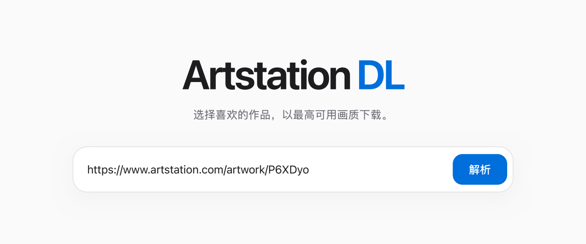

# Artstation DL

在 ArtStation 上收集参考图时，一张封面往往对应一整组画面。Artstation DL 可以展开作品里的静态图片，按张挑选，也可以一次下载多部作品。图片按作品整理为 ZIP，并优先获取当前可访问的最高画质。能否下载 4K，取决于该张图片在 ArtStation 上实际提供的档位。

| 你想怎么用 | 安装包 |
| --- | --- |
| 已经在 Chrome 打开画师主页、系列或作品，直接下载当前页面 | [下载 Chrome 插件 v1.1.1](https://github.com/AKSA0397/Artstation-DL/raw/refs/heads/main/Artstation-DL-Chrome.zip) |
| 在 Mac 上粘贴画师主页或单个作品链接进行解析 | [下载 Mac 版](https://github.com/AKSA0397/Artstation-DL/raw/refs/heads/main/ArtStation-Downloader-Mac.zip) |

## Chrome 插件

1. 使用 Chrome 116 或更新版本。解压插件 ZIP，在地址栏输入 `chrome://extensions`，打开「开发者模式」。
2. 点击「加载未打包的扩展程序」，选择解压后**直接包含 `manifest.json` 的文件夹**。安装后保留这个文件夹。
3. 打开要下载的 ArtStation 页面，在工具栏的扩展程序菜单中点击 **Artstation DL**，右侧会打开下载面板。切换页面后可点「重新读取」。

| 当前页面 | 下载方法 |
| --- | --- |
| 画师主页 | 勾选一部或多部作品，或点「全选」，再下载。点作品封面可以进入作品挑图。 |
| 系列页 | 直接点「下载整个系列」打包该系列中的作品，或勾选其中几部再下载。 |
| 单个作品页 | 点「下载整组」获取封面下的全部可读取图片，或只勾选想保存的几张。 |

打包期间请保持 ArtStation 标签页和侧边栏打开。

## Mac 版

1. 将安装包解压到一个文件夹，双击其中的 `Start.command`。启动后浏览器会打开本机下载页。如果启动器提示缺少运行环境，请安装 Node.js 22 或更新版本后重试。
2. 粘贴画师主页或作品链接，点「解析」。在画师主页的结果中，点封面可以查看该作品里的图片。勾选作品则会下载所选作品里的图片。
3. 在单个作品内直接点「下载整组」，或勾选部分图片后点「下载所选」。下载期间保持启动窗口打开，用完后在该窗口按 `Control + C` 退出。

## Mac 版使用截图

*Mac 版 · 粘贴画师主页或作品链接，再点「解析」。*
